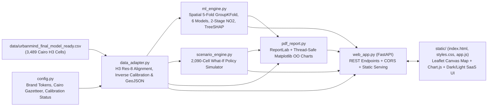

<div align="center">


# UrbanMind AI

### *"Understand Locations. Make Smarter Real Estate & Urban Decisions."*

**B2B Spatial Intelligence & Urban Decision Support System (SaaS) for Greater Cairo, Egypt**

[](#how-to-run-locally)
[](#rest-api-reference)
[-00E5FF)](#how-the-code-works-architecture--data-flow)
[](#machine-learning-engine--verified-benchmarks-v21)
[](#how-to-test)

</div>

---

## Table of Contents

1. [What Is UrbanMind AI?](#what-is-urbanmind-ai)
2. [The Business Idea & Market Strategy](#the-business-idea--market-strategy)
3. [The 4 Integrated Platform Modules](#the-4-integrated-platform-modules)
4. [How the Code Works (Architecture & Data Flow)](#how-the-code-works-architecture--data-flow)
5. [Machine Learning Engine & Verified Benchmarks (v2.1)](#machine-learning-engine--verified-benchmarks-v21)
6. [What-If Scenario Engine Benchmark](#what-if-scenario-engine-benchmark)
7. [How to Run Locally](#how-to-run-locally)
8. [How to Test](#how-to-test)
9. [Running in Google Colab](#running-in-google-colab)
10. [REST API Reference](#rest-api-reference)
11. [Repository Structure & Key Documents](#repository-structure--key-documents)
12. [Data Sources, Licensing & Honest Limitations](#data-sources-licensing--honest-limitations)

---

## What Is UrbanMind AI?

Evaluating a land parcel, neighborhood, or infrastructure investment in a megacity like **Greater Cairo** typically requires weeks of manual GIS work across incompatible demographic, road, transit, vegetation, and air-quality datasets.

**UrbanMind AI** unifies **5 Core Urban Data Domains** across **3,489 Uber H3 Resolution-8 hexagonal cells** (`3,488` unique polygons, ~0.87 km² each; **2,090 active populated cells** with mapped roads for simulation) into a single commercial B2B web platform and reproducible ML pipeline—turning raw spatial data into:
- **Interactive Location Intelligence** (click any Cairo hexagon or search any neighborhood)
- **Leakage-Audited Predictive Analytics** with **TreeSHAP** feature explanations
- **Pre-Investment What-If Simulations** (test population growth, added transit stops, and public parks before spending capital)
- **Print-Ready Branded PDF Decision Reports** for executive committees and real estate clients

---

## The Business Idea & Market Strategy

### The Core Problem
1. **Fragmented & Technical Spatial Silos:** Population (WorldPop), road topology (OpenStreetMap), public transit catchments, accessible parks vs. satellite vegetation (Sentinel-2 NDVI), and air pollution (Sentinel-5P NO₂) live in disconnected formats. SME real estate developers and brokerages lack dedicated GIS teams to combine them.
2. **High Cost of Blind Capital Decisions:** Launching residential compounds in transit-isolated cells, mispricing districts relative to livability fundamentals, or building infrastructure in low-priority zones wastes millions in CAPEX.

### Target Customers & Go-To-Market (GTM) Wedge
- **Phase 1 — Fast-Entry Commercial B2B Beachhead:**
  - **SME Real Estate Developers & Local Builders:** Rapid land-acquisition screening and amenity gap planning.
  - **Real Estate Brokerages & Property Consultants:** Objective neighborhood comparison PDFs to advise buyers and investors.
  - **Urban Planning & Engineering Consultancies:** Automating baseline multi-domain spatial audits from weeks to minutes.
- **Phase 2 — Enterprise & Public Sector:**
  - **Tier-1 Developers, Municipalities (NUCA / GOPP) & Environmental Agencies:** Long-cycle capital budget prioritization and environmental monitoring.
- **GTM Playbook:** Offer mid-sized Cairo firms a **free Pilot Location Decision Report** on a neighborhood they *already know intimately* → prove accuracy in 5 minutes → convert to paid Single/Comparison reports → graduate repeat buyers into recurring SaaS seats.

### Monetization Ladder *(Indicative Planning Hypotheses — To Validate in Pilots)*
| Tier | Timing | Indicative Price Hypothesis | Scope |
|---|---|---|---|
| **Freemium Explorer** | Live (MVP) | **Free** | Greater Cairo H3 map exploration, 5-domain inspection, district search |
| **Single-Area / Comparison PDFs** | Phase 1 | **EGP 4,500 – 7,500** (~USD 90–150) | Branded executive PDF dossiers, ML predictions + SHAP, scenario runs |
| **Professional SaaS Workspace** | Phase 2 | **EGP 6,000 / mo** (~USD 120/mo) | 3 seats, unlimited PDF exports, full SHAP, Phase 2 real estate pricing layer |
| **Enterprise & REST API** | Phase 3–4 | **EGP 180,000+ / yr** (~USD 3,600+/yr) | Multi-city Egypt coverage (Alexandria, Port Said, NAC), CAPEX simulator, API |

> For the full investor Business Plan, TAM/SAM/SOM sizing, 18-month budget, and 10-Slide Pitch Deck, see [`docs/UrbanMind_AI_Business_Plan.md`](docs/UrbanMind_AI_Business_Plan.md) and [`docs/UrbanMind_AI_Pitch_Deck_10_Slides.md`](docs/UrbanMind_AI_Pitch_Deck_10_Slides.md).

---

## The 4 Integrated Platform Modules

1. **Module A — Urban Intelligence Map (5 Core Domains):**
   - **Population:** Total population & density (WorldPop 2026).
   - **Roads & Traffic:** Road length, density, intersections, dead-end ratio, one-way ratio, bridge/tunnel ratios, structural network friction.
   - **Public Transit:** Metro, Bus, BRT, LRT, and Rail stops; walking buffers (`400m`, `800m`, `1,200m`); distance to nearest stop; Transit Accessibility Score.
   - **Green Space:** Separates general satellite vegetation (`NDVI`, including private compounds/agriculture) from **accessible Public Green Spaces / Parks** (`m²` and park count).
   - **Air Quality:** Sentinel-5P tropospheric **NO₂** (mean & P90) and proximity to **PM2.5** monitors.
   - *District Labelling & Search:* Curated 30-district Cairo gazetteer (English & Arabic) + cached/rate-limited (`≤1 req/s`) OpenStreetMap Nominatim fallback. Cells `>3 km` from a landmark are transparently prefixed `"Near <District> (X.X km)"`.

2. **Module B — Predictive Analytics & Explainable AI (SHAP):**
   - Runs **6 leakage-audited classifiers** + a **Two-Stage Spatial + Urban Levers NO₂ Ridge Regression** model.
   - Uses **native TreeSHAP** (`CatBoost`, `LightGBM`, `XGBoost`). When `Random Forest` or `MLP` is selected/winning, explanations are routed to a clearly labelled sibling tree-model proxy (`shap_model` / `shap_is_proxy_model`) rather than fake heuristics.

3. **Module C — What-If Scenario Lab:**
   - Interactive deterministic simulator over Greater Cairo's **2,090 active populated cells** with 4 sliders:
     - `Population Change (%)` (`-30%` to `+150%`)
     - `Additional Transit Stops / Treated Cell` (`0` to `20`)
     - `Additional Public Green Area (m²)` (`0` to `100,000 m²`)
     - `Top Pressure Cells Treated (%)` (`0%` to `100%`) + optional *"Force-treat selected cell"*
   - Tracks **Baseline vs. Hypothetical vs. Net Change** across `Population per road km`, `Green m² per person`, and `Transit stops per 1,000 people`.

4. **Module D — Decision Reports & Area Comparison:**
   - Side-by-side district benchmarking (e.g., *Nasr City vs. Maadi*) with a directional scorecard, 5-domain Cairo percentile radar chart, ML comparison table, and one-click **print-ready branded PDF export** (`ReportLab` + thread-safe 220-DPI `Matplotlib` OO `Figure` charts).

---

## How the Code Works (Architecture & Data Flow)



### Module-by-Module Code Walkthrough
- [`run_app.py`](run_app.py): CLI entrypoint (`--host`, `--port`) that initializes FastAPI via `create_app()` and serves the platform with Uvicorn.
- [`src/urbanmind/config.py`](src/urbanmind/config.py): Centralizes the brand color palette (extracted from the logo), `CAIRO_GEO_CALIBRATION`, `PHYSICAL_CALIBRATION`, `CALIBRATION_STATUS` (`inverted` vs `assumed_scale` provenance), `DISTRICT_LABEL_MAX_KM = 3.0`, the 30-district Cairo gazetteer (`CAIRO_DISTRICTS`), 9 map layer specs (`MAP_LAYERS`), and `FEATURE_LABELS`.
- [`src/urbanmind/data_adapter.py`](src/urbanmind/data_adapter.py):
  - Auto-downloads the CSV from Google Drive via `gdown` if missing locally.
  - Detects standardized Z-scored inputs vs. raw inputs, reconstructs exact **Uber H3 Res-8** hexagons (`r = 0.999978` vs geodesic area, `4.9m` median centroid residual), and recovers exact integer counts (`_recover_log1p_integer_count`) plus the `2,090`-cell active populated mask.
  - Builds a cached `FeatureCollection` GeoJSON (`3,488` unique H3 polygons) and handles ranked district search + cached/rate-limited Nominatim geocoding.
- [`src/urbanmind/ml_engine.py`](src/urbanmind/ml_engine.py):
  - Trains/caches all models into `artifacts/urbanmind_models_v2.joblib` and writes `artifacts/benchmark_summary_v2.json`.
  - Enforces **Spatial 5-Fold `GroupKFold`** across 10 KMeans geographic blocks, fold-local median cutoffs, fold-local Spearman proxy screening (`|ρ| < 0.80`), `SimpleImputer` + `SMOTE` inside `ImbPipeline`, **spatial block bootstrap 95% CIs**, **1 km spatial buffer sensitivity checks**, and **native TreeSHAP**.
- [`src/urbanmind/scenario_engine.py`](src/urbanmind/scenario_engine.py): Vectorized NumPy engine computing percentile-based composite stress (`0–1`, critical threshold `0.75`) over the `2,090` active cells, targeting top-`K%` stressed cells and aggregating Top-10 anchor districts.
- [`src/urbanmind/pdf_report.py`](src/urbanmind/pdf_report.py): Thread-safe (`Figure` + `FigureCanvasAgg`, zero global `pyplot`) ReportLab generator with XML-escaped user labels (`xml.sax.saxutils.escape`), strict `<` zero-safe percentiles, `≈` estimated-scale markers, and open-data attribution footers.
- [`src/urbanmind/web_app.py`](src/urbanmind/web_app.py): FastAPI application exposing all REST endpoints, Pydantic input validation, configurable `URBANMIND_CORS_ORIGINS`, and `BackgroundTask` cleanup of temporary PDF files.
- [`src/urbanmind/static/`](src/urbanmind/static/index.html): Zero-build-step frontend using Leaflet (`preferCanvas: true`) and Chart.js with Dark/Light theme toggle, `?tab=` deep-linking, XSS-escaped rendering (`esc()`), and live synchronization across all 4 modules.

---

## Machine Learning Engine & Verified Benchmarks (v2.1)

All metrics below are loaded directly from [`artifacts/benchmark_summary_v2.json`](artifacts/benchmark_summary_v2.json) (`version: 2.1.0`), evaluated via **Leakage-Audited Spatial 5-Fold `GroupKFold`** (10 geographic blocks) with **Spatial Block Bootstrap 95% CIs**:

| Predictive Target | Task | Clean Features | Winning Model (`best-of-6 OOF`) | Spatial Macro-F1 (Block 95% CI) | 1 km Buffered F1 | ROC-AUC | Naive Baseline |
|---|---|---:|---|---:|---:|---:|---:|
| **Urban Intervention Priority** | 3-Class | `42` (folds `40–45`) | **CatBoost** | **`0.6530`** (`0.5669–0.7093`) | `0.6569` | `0.8319` | `0.1667` |
| **Traffic Structural Susceptibility** | 3-Class (`Set B`) | `7` | **Random Forest** | **`0.7265`** (`0.6621–0.7659`) | `0.7229` | `0.8813` | `0.1773` |
| **Transit Availability Gap** | Binary (`SMOTE`) | `27` (zero `transit_*`) | **XGBoost** | **`0.8438`** (`0.7089–0.8931`) | `0.8433` | `0.9638` | `0.4665` |
| **High Transit Accessibility** | Binary (`SMOTE`) | `25` (zero `transit_*`) | **Random Forest** | **`0.8681`** (`0.7722–0.9114`) | `0.8643` | `0.9519` | `0.4450` |
| **Public Green Space Availability** | Binary (`SMOTE`) | `25` (zero park cols) | **CatBoost** | **`0.7381`** (`0.6708–0.7714`) | `0.7392` | `0.9127` | `0.4706` |
| **High NO₂ Air Pollution Zone** | Binary (`SMOTE`) | `28` (zero `no2`/coords) | **Random Forest** | **`0.7666`** (`0.6504–0.8570`) | `0.7552` | `0.8433` | `0.3334` |

- **Two-Stage Spatial + Urban Levers NO₂ Ridge Regression** (5-Fold ~11.1 km spatial block OOF, `22` urban levers):
  - Urban Levers Only: `R² = 0.3242` (`RMSE = 0.8101`)
  - Stage 1 Spatial Field Only: `R² = 0.8492` (`RMSE = 0.3827`)
  - **Full Two-Stage:** **`R² = 0.8511`** (`RMSE = 0.3802`, `MAE = 0.2746`)
- **Priority Index Stability (1,000-run Dirichlet simulation):** Mean Spearman `ρ = 0.808` (median `0.872`), `76.1%` high-priority retention, `1.9%` extreme Low↔High jumps.
- **Leakage & Ablation Audits:**
  - *Target 1 Set A vs Set B:* Removing 4 friction-reconstructing road features drops inflated `0.9757` to honest contextual `0.7265`.
  - *High-NO₂ Station-Proximity Ablation:* Removing `air_quality_*` station features yields `0.7483` (vs. `0.7666`).
  - *Target 2 Deferral:* *Traffic Demand Capacity Pressure* is deferred due to `99.25%` missing speed/capacity coverage (`26 / 3,489` valid rows).

---

## What-If Scenario Engine Benchmark

Computed deterministically across Greater Cairo's **2,090 active populated cells**:

| Scenario Configuration | City Mean Stress | Critical High-Stress (`≥ 0.75`) | Treated Cells | Infrastructure Added |
|---|---:|---:|---:|---|
| **Baseline (Current Cairo)** | **`0.715`** | **`47.8%`** | `0` | — |
| **Pop +20% (No Intervention)** | `0.722` | `49.7%` | `0` | — |
| **Pop +20% \| +2 Stops (Top 10%)** | `0.692` | `39.7%` | `210` | `+420` stops |
| **Pop +20% \| +5,000 m² Green (Top 10%)** | `0.693` | `39.7%` | `210` | `+105.0 Ha` parks |
| **Pop +20% \| Combined Package (Top 20%)** | **`0.600`** | **`29.7%`** | **`418`** | **`+836` stops & `+209.0 Ha`** |

---

## How to Run Locally

### Prerequisites
- **Python 3.11+**
- Dataset `data/urbanmind_final_model_ready.csv` (already included in `data/`, or auto-downloaded via `gdown` on startup)

### 1. Clone & Install Dependencies
```bash
git clone <your-repo-url>
cd depi
pip install -r requirements.txt
```

### 2. Launch the Web SaaS Platform
```bash
python run_app.py --host 127.0.0.1 --port 8000
```
- On first startup without cached artifacts, `UrbanMLEngine` automatically trains and caches models to `artifacts/urbanmind_models_v2.joblib` (~4–5 minutes). Subsequent launches load the cached bundle in seconds.
- Open **http://127.0.0.1:8000** in your browser.
- Interactive OpenAPI/Swagger docs: **http://127.0.0.1:8000/docs**.

### Optional Environment Variables
- `URBANMIND_CORS_ORIGINS`: Comma-separated allowed CORS origins (default: `http://127.0.0.1:8000,http://localhost:8000`).

---

## How to Test

Run the full **14-test automated technical & adversarial audit suite** (works directly with standard Python—no `pytest` installation required):

```bash
python tests/test_urbanmind.py
```

Or with `pytest` if installed:
```bash
python -m pytest tests/test_urbanmind.py -v
```

The 14 tests verify:
1. Greater Cairo H3 bounds, `3,489` rows, `2,090` active cells, and GeoJSON integrity
2. Curated Cairo district search, short-query rejection, and `3 km` distance label guard
3. Zero-proxy feature screening, Set B isolation, Dirichlet stability, and Two-Stage NO₂ R²
4. Per-cell inference and true TreeSHAP driver sensitivity to predicted class
5. What-If scenario benchmark reproduction, monotonicity, and `-15%` population decline edge case
6. Branded PDF generation (single + comparison), XML-injection safety (`<b>X</para> & Co`), and 4-thread concurrent generation
7. All FastAPI REST endpoints (`/`, `/api/health`, `/api/overview`, `/api/geojson`, `/api/cell/{id}`, `/api/search`, `/api/predict/{id}`, `/api/scenario`, `/api/compare`, `/api/report/pdf`) + `calibration_status` exposure

---

## Running in Google Colab

Open [`UrbanMind_AI_Enhanced_Brand_Satellite_LocationUX.ipynb`](UrbanMind_AI_Enhanced_Brand_Satellite_LocationUX.ipynb) in Google Colab:
- **Standalone Colab Mode:** Run **Cell 02** (installs dependencies and downloads the CSV via `gdown`), then run **Cells 41–44** to launch the interactive Folium + Gradio dashboard.
- **Repository-Synced Mode:** When the `src/urbanmind` package is present in the working directory, Cell 41 automatically bridges to the canonical `src/urbanmind` modules to prevent code drift.

---

## REST API Reference

| Method | Endpoint | Description |
|---|---|---|
| `GET` | `/api/health` | Health check, dataset row counts, and loaded model count |
| `GET` | `/api/overview` | Brand tokens, KPIs, map layer definitions, district directory, `calibration_status`, scenario benchmarks |
| `GET` | `/api/geojson` | Cached `3,488`-feature Greater Cairo H3 Res-8 GeoJSON |
| `GET` | `/api/cell/{cell_id}` | Full 5-domain dossier, Cairo percentile ranks, and `calibration_status` |
| `GET` | `/api/search?q=...` | H3 ID lookup, ranked Cairo gazetteer match, or cached/throttled Nominatim fallback |
| `GET` | `/api/benchmarks` | Full Spatial 5-Fold GroupKFold leaderboard, block CIs, 1 km buffer F1, and NO₂ ablation |
| `GET` | `/api/predict/{cell_id}` | Predictions across all 6 classifiers + TreeSHAP drivers + Two-Stage NO₂ decomposition |
| `POST` | `/api/scenario` | Run What-If policy simulation (`pop_growth_pct` `-30..150`, `added_stops`, `added_green_m2`, `top_pct`) |
| `GET` | `/api/compare?cell_a=...&cell_b=...` | Side-by-side 5-domain & ML comparison + directional scorecard |
| `POST` | `/api/report/pdf` | Generate and download a branded print-ready PDF Decision Report (auto-cleaned after response) |

---

## Repository Structure & Key Documents

```text
d:\depi\
├── 3b7fb3d5-608c-4c37-bea0-7d55f04d13d8.jpg                       # Official UrbanMind AI logo
├── README.md                                                      # You are here
├── requirements.txt                                               # Python dependencies
├── run_app.py                                                     # One-command FastAPI/Uvicorn launcher
├── UrbanMind_AI_Enhanced_Brand_Satellite_LocationUX.ipynb         # Colab research + Gradio GUI notebook
├── UrbanMind_AI_Proposal.pdf                                      # Original project proposal
├── data/
│   └── urbanmind_final_model_ready.csv                            # Greater Cairo 3,489-cell H3 dataset
├── artifacts/
│   ├── urbanmind_models_v2.joblib                                 # Cached Spatial-CV models (v2.1.0)
│   └── benchmark_summary_v2.json                                  # Verified ML & ablation benchmarks
├── src/urbanmind/
│   ├── __init__.py
│   ├── config.py                                                  # Brand palette, Cairo gazetteer, calibration flags
│   ├── data_adapter.py                                            # H3 Res-8 alignment, inverse calibration, search
│   ├── ml_engine.py                                               # Spatial CV, 6 classifiers, 2-Stage NO2, TreeSHAP
│   ├── scenario_engine.py                                         # 2,090-cell What-If impact engine
│   ├── pdf_report.py                                              # Thread-safe ReportLab PDF + 220-DPI OO charts
│   ├── web_app.py                                                 # FastAPI REST API & static file server
│   └── static/                                                    # Frontend (index.html, styles.css, app.js)
├── tests/
│   └── test_urbanmind.py                                          # 14 automated technical & security audit tests
└── docs/
    ├── UrbanMind_AI_Business_Plan.md                              # Executive Business Plan (+ .pdf)
    ├── UrbanMind_AI_Pitch_Deck_10_Slides.md                       # 10-Slide Investor Pitch Deck (+ .html)
    ├── UrbanMind_AI_Decision_Report_Template.md                   # Client PDF Report Template
    ├── UrbanMind_AI_Sample_Decision_Report_NasrCity_vs_Maadi.pdf  # Live sample PDF (Nasr City vs. Maadi)
    ├── UrbanMind_AI_User_Guide_AR.pdf                             # Arabic RTL User Guide (with screenshots)
    ├── UrbanMind_AI_Independent_Audit_Report.md                   # Independent adversarial audit report
    └── UrbanMind_AI_Fix_Tasks.md                                  # 22-task remediation checklist
```

---

## Data Sources, Licensing & Honest Limitations

### Data Sources & Licences
- **OpenStreetMap:** © OpenStreetMap contributors, licensed under **ODbL** (road topologies, intersections, transit stops, Nominatim geocoding).
- **WorldPop (2026):** Demographic & population density rasters licensed under **CC BY 4.0**.
- **Copernicus Sentinel-2 & Sentinel-5P:** European Union Copernicus open-access Earth observation data (NDVI & tropospheric NO₂ attribution).

### Transparent Scope Boundaries
1. **Standardized CSV Inverse Calibration:** Because the project ingests the pre-standardized `urbanmind_final_model_ready.csv`, integer counts, population, road length, and public green area are mathematically inverted, whereas **NO₂, NDVI, nearest transit/PM2.5 distances, and bridge/tunnel ratios** use monotone display-scale assumptions and are prefixed with `≈` in the UI and PDF (*percentile rankings are exact; absolute physical units are approximate pending raw unscaled GeoPackage ingestion in Phase 1*).
2. **Duplicate Imputed Centroid:** One row in the source CSV shares an imputed median lat/lon with another cell (`3,489` rows → `3,488` unique H3 polygons), handled cleanly via unique `cell_id` keys.
3. **District Labels:** Assigned via nearest curated Cairo landmark (`>3 km` prefixed `"Near <District>"`), pending official CAPMAS/GOPP administrative boundary polygons in Phase 2.
4. **Deferred Target:** *Target 2 (Traffic Demand Capacity Pressure)* is excluded from MVP due to `99.25%` missing road speed/capacity observations.
